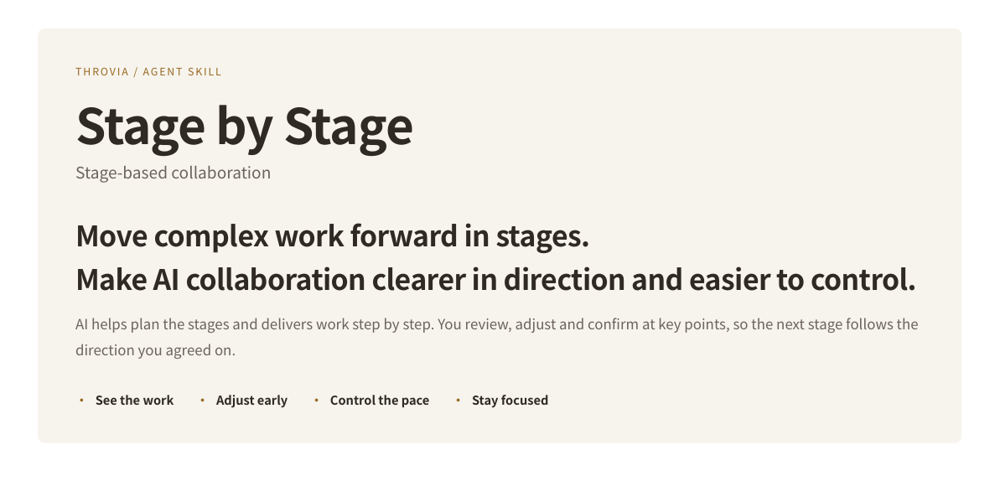
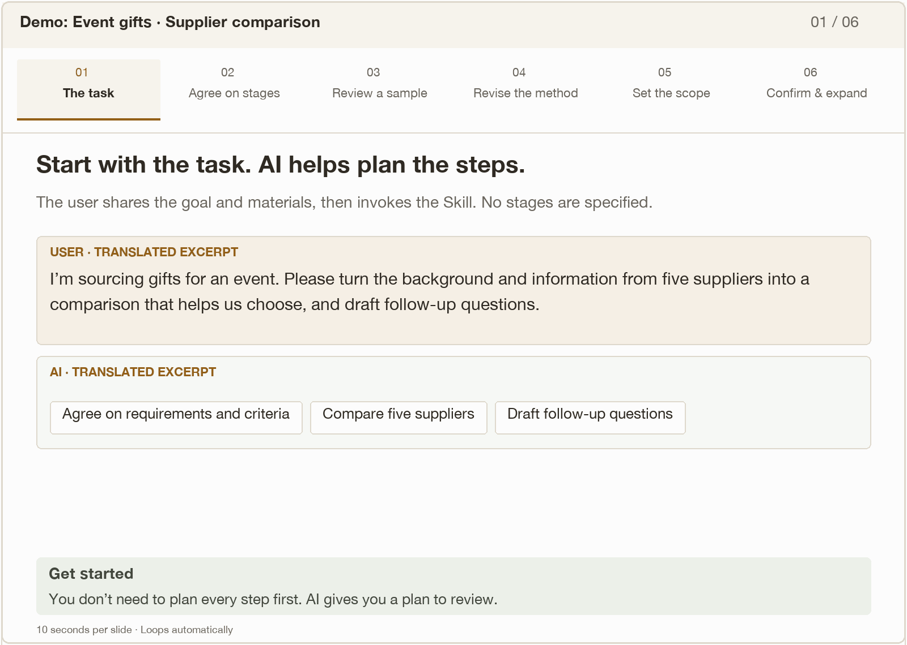

[Core value](#value) · [Use cases](#scenes) · [Demo](#demo) · [Installation](#install) · [Quick start](#start) · [FAQ](#faq) · [简体中文](README.zh-CN.md)

You know what you need to deliver, but may not have every step worked out.

Stage by Stage asks AI to propose stages, then work through the plan you confirm.

Review concrete results, adjust the approach and scope, and decide when to move on.

Open-source Agent Skill · Codex · Claude Code · MIT · skill & documentation

<a id="value"></a>

## Make your judgment count in the work that follows.

See the results, adjust the direction, and decide how to continue.

Agree on stages → Deliver current work → Flag key issues → Review and adjust → Confirm and continue

### See the work

Review progress before the final result

Check a direction, structure or sample while the work is still in progress, and judge whether it meets your needs.

**How it works** Deliver reviewable results at each stage, with progress, issues and decisions to confirm.

### Adjust early

Surface problems before committing more work

AI flags key issues, missing information and uncertainty, and explains their impact so you can decide whether to adjust.

**How it works** Flag issues with the deliverable. You decide what to address or defer; revisions are delivered again before proceeding.

### Control the pace

Decide when to continue

Keep room to compare options, add information or reconsider before deciding how the work should proceed.

**How it works** Pause after each stage and wait for explicit confirmation before starting the next.

### Stay focused

Keep attention on the current priority

Keep discussion and output centered on the current problem, rather than letting the scope grow with every turn.

**How it works** Work within the current stage and carry confirmed changes and scope into later deliverables.

**Not sure how to break the task down?** AI proposes stages for you to review and adjust. If you already have a plan, it can follow that.

<a id="scenes"></a>

## When the task needs your judgment, not just more output:

Useful when steps depend on one another and unresolved choices could cause later rework.

Starting unfamiliar work

### You know the deliverable, but not the path.

**Example: A first partnership proposal or research report**

Ask AI to propose stages, then review the direction, outline and samples along the way.

Gain a path you can review; key conclusions in an unfamiliar field still need verification.

Turning ideas into results

### You have judgment, but do not want to plan every step alone.

**Example: A work report or event plan**

Ask AI for a structure or options. Choose and adjust before it expands the content and execution details.

Let AI handle planning and drafting while you focus on important decisions.

Giving later work a clear basis

### Each response seems reasonable, yet the whole task drifts.

**Example: Supplier comparisons or a batch of research materials**

Review a small sample first. Agree on changes and what to defer, then expand using the confirmed method.

Calibrate the approach and scope before the work expands.

These illustrate where the approach can help. Simple, clearly specified tasks that can be completed in one pass do not need forced stages.

<a id="demo"></a>

## From a sourcing task to a comparison you have reviewed.



Six slides, 10 seconds each, on a loop. Excerpts and summaries from the test conversation; English excerpts are translated.

[中文 GIF](assets/demo-zh.gif) · [English GIF](assets/demo-en.gif)

<details>
<summary>Read the demonstration at your own pace</summary>

### Start with a task, even without a plan.

The user describes the goal, provides materials and invokes the Skill.

USER · TRANSLATED EXCERPT

I’m sourcing gifts for an event. Please turn the background and five suppliers’ materials into a comparison that helps us choose, and draft follow-up questions.

AI · TRANSLATED EXCERPT

I suggest three stages:

Clarify requirements and criteria · Compare five suppliers · Draft follow-up questions

**Get started** AI offers a path you can review; you do not need to plan every step first.

### AI proposes the stages. You can adjust them.

The user changes three stages to four, adding a two-supplier sample.

USER · SUMMARY OF STAGES

1 Agree on criteria · 2 Create an A/C sample · 3 Expand to all five + replies · 4 Recommend and draft questions

AI · TRANSLATED EXCERPT

I’ll follow your four stages. For now, I’ll only read the materials and propose the criteria and table structure for your review.

**Control the pace** The task follows the stages you agree on.

### Review two suppliers before expanding.

After the method is confirmed, AI delivers an A/C sample. The other three are not yet expanded.

SAMPLE · SUMMARY

A: total including tax ¥3,660; estimated dispatch Dec 14, with delivery usually taking 1–2 days.<br>
<br>
C: total including tax ¥3,703; estimated arrival Dec 12–14.<br>
<br>
On-time arrival remains unconfirmed for both.

**See the work** Judge a concrete result, rather than relying on an outline alone.

### Turn a key distinction into clear comparison fields.

The comparison format is refined within the sample stage.

USER · TRANSLATED EXCERPT

Please separate dispatch date, estimated arrival and the explicitly committed latest arrival date. An estimate must not be presented as a guarantee.

REVISED SAMPLE · SUMMARY

Dispatch: A estimated Dec 14; C not provided.<br>
Estimated arrival: A inferred Dec 15–16; C Dec 12–14.<br>
Committed latest arrival: not provided for either.

**Adjust early** Refine the method before applying it to the remaining work.

### Consider more. Decide what belongs in scope.

At the user’s request, AI suggests additional considerations. Two are deferred.

USER · TRANSLATED EXCERPT

Suggestions 3 and 4 go a little too far for now. Let’s leave them out.

AI · TRANSLATED EXCERPT

Receipt inspection arrangements and checks on contracting, payment and invoicing entities are deferred. They will not be comparison items or follow-up questions in this round.

**Stay focused** Useful suggestions do not automatically become extra work.

### Your decisions carry into the next stage.

The user confirms the sample and provides new supplier replies.

USER · TRANSLATED EXCERPT

These two look good. Use the confirmed method for all five suppliers, incorporate the new replies, and mark where earlier statements were explicitly revised.

ALL-FIVE COMPARISON · SUMMARY

Keep the three date fields · Carry forward added criteria · Mark revised information · Retain the two deferrals

<br>
Complete the comparison first; recommendations remain in the next stage.

**Continue after confirmation** The next deliverable preserves your changes and agreed scope.

</details>

**What this demonstrates:**AI helps you plan. You use stage results to refine the approach and scope, then have AI carry those decisions forward.

<a id="install"></a>

## Two ways to install. Choose the one that fits.

Download and place the folder yourself, or install from the terminal.

[Download Skill ZIP ↓](https://github.com/THROVIA/stage-by-stage/raw/refs/heads/main/stage-by-stage.zip)

**This button downloads a ZIP; it does not install the Skill.**<br>
The same package can be used on Windows and macOS with a compatible AI tool. Extract it, then use one of the methods below.

OPTION A / MANUAL INSTALLATION

### Download → extract → place the complete folder

1. Extract the ZIP and locate `stage-by-stage`. Open it and check that `SKILL.md` is directly inside.
2. Move the complete folder, including `assets` and `agents`, to the location for your tool.
3. Return to the tool and invoke the Skill. If it does not appear, restart the tool and check the path.

| Tool | macOS / Linux user folder | Windows user folder |
| --- | --- | --- |
| Codex | `~/.agents/skills/stage-by-stage/` | `%USERPROFILE%\.agents\skills\stage-by-stage\` |
| Claude Code | `~/.claude/skills/stage-by-stage/` | `%USERPROFILE%\.claude\skills\stage-by-stage\` |

`~` and `%USERPROFILE%` refer to your own user home directory. The relative structure is the same; the full path depends on your account and environment.

<details>
<summary>Find the folder and check the layout</summary>

On macOS, press `⌘⇧G` in Finder and enter the parent folder, such as `~/.agents/skills/`. Create missing folders first.<br>
On Windows, paste `%USERPROFILE%\.agents\skills\` into File Explorer. Directories beginning with a dot may be hidden.

The final file should be `…/skills/stage-by-stage/SKILL.md`, not `…/skills/stage-by-stage/stage-by-stage/SKILL.md`.<br>
If your tool runs in WSL, a container or a remote environment, install inside that environment. A working installation does not need to be duplicated.

</details>

OPTION B / COMMAND LINE

### Install from the GitHub repository

Requires Node.js 22.20 or later and network access to run the Skills CLI. Run the command for your tool in macOS Terminal or Windows PowerShell; no manual ZIP download is needed.

**Terminal · Install for Codex**

```text
npx skills add THROVIA/stage-by-stage --skill stage-by-stage -a codex -g --copy
```

**Terminal · Install for Claude Code**

```text
npx skills add THROVIA/stage-by-stage --skill stage-by-stage -a claude-code -g --copy
```

Choose the command for your tool. `-g` installs for your user across projects; `--copy` copies the files rather than linking them. To install a ZIP you already extracted, replace `THROVIA/stage-by-stage` with `./stage-by-stage` while in its parent folder, or use the full path in quotes.

[Skills CLI reference ↗](https://github.com/vercel-labs/skills/blob/main/docs/commands.md)

Tool documentation: [Codex skills ↗](https://learn.chatgpt.com/docs/build-skills) · [Claude Code skills ↗](https://code.claude.com/docs/en/skills). Paths describe personal local installations; cloud and web environments use their own installation methods.

<a id="start"></a>

## Bring a task you are working on.

Share the goal, materials and constraints. You do not need every stage planned in advance.

**After installation, invoke the Skill in your AI chat, then describe the task.** Do not run these chat commands in a terminal.

**Codex · AI chat · not a terminal command**

```text
$stage-by-stage
```

**Claude Code · AI chat · not a terminal command**

```text
/stage-by-stage
```

In Codex CLI or the IDE extension, you can also use `/skills` to select the Skill. In Claude Code, type the slash command in chat, then describe your task. In other interfaces, use their Skill selector.

Example task input

```text
Please use stage-by-stage to compare suppliers for an upcoming event.
I’ll provide the requirements and supplier materials. Focus on quantity, total budget and arrival dates. Propose the stages first, and confirm them with me before starting.
```

This is only an example. Adapt it to a task of your own.

If you already have stages in mind, include them. The Skill follows the plan you confirm.

<a id="faq"></a>

## Usage, boundaries and choosing the right tool.

<details>
<summary>Why not just say “work step by step and wait for my confirmation”?</summary>

That may be enough for simple tasks.<br>
Stage by Stage makes stage planning, reviewable deliverables, issue reminders, revisions and confirmation reusable rules, so you can use a consistent approach across tasks.

</details>

<details>
<summary>Can I use it if I do not know how many stages I need?</summary>

Yes.<br>
AI proposes a short plan, explaining what each stage produces and what you need to judge. You can adjust it before starting. Existing confirmed plans are reused.

</details>

<details>
<summary>Will confirming every step create more work?</summary>

Stages are built around decisions and outputs that affect later work, such as a direction, choice or sample—not every small action.<br>
You can adjust the stages or explicitly remove the pause requirement.

</details>

<details>
<summary>Must every issue AI raises be resolved before continuing?</summary>

No.<br>
You decide what to address now and what to defer. Deferred issues retain their limitations. If a gap makes reliable progress impossible, AI should explain what is affected and what is needed to continue.

</details>

<details>
<summary>How does it compare with other planning and staged-execution Skills?</summary>

Choose by the help you need right now.<br>
These are differences in emphasis, not claims that other Skills lack similar capabilities.

| Skill | Use it when you want to… | Main emphasis |
| --- | --- | --- |
| **Stage by Stage** | Get help planning, judge concrete stage results, and keep subsequent work aligned with your decisions. | Agree on stages; deliver reviewable work and flag issues; implement changes and await confirmation; retain focus and agreed scope. |
| [Planning with Files ↗](https://github.com/OthmanAdi/planning-with-files) | Recover the plan, findings and progress across a long task or after an interruption. | Keep plans, findings and execution state in files to support continuity and recovery. |
| [Phase-Gated Workflow ↗](https://github.com/sayed-moin-ahmed/phase-gated-workflow) | Move software engineering work through defined phases with approval before advancing. | Organize research, design, review, implementation and validation with approval gates between phases. |

Based on the linked project documentation, not a comparative performance test.

</details>

<details>
<summary>How does it differ from Task Brief? Do I need both?</summary>

[Task Brief](https://github.com/THROVIA/Task_Brief) helps clarify what to solve and how far to take the task.<br>
Stage by Stage organizes delivery, review and progress into stages. Either can be used alone. If the goal and scope are still unclear, you can use Task Brief first.

</details>

<details>
<summary>What if AI advances early or fails to apply a change?</summary>

Point out the current stage and what has not been confirmed. Ask it to correct the current deliverable and check that the Skill is loaded.<br>
If it happens repeatedly, keep the relevant exchange for feedback.<br>
The Skill provides collaboration rules; execution still depends on the model and tool.

</details>

<a id="feedback"></a>

## If it helps, star the project and share your experience.

A Star makes the project easier to find again and helps others discover it. Questions, ideas and feedback are welcome. Please remove sensitive information before sharing a conversation.

- [Star the project](https://github.com/THROVIA/stage-by-stage)
- [Follow THROVIA on X ↗](https://x.com/Throvia)
- [Discuss & share feedback ↗](https://github.com/THROVIA/stage-by-stage/issues)

Share your task, the relevant response and what happened next in an Issue. Follow THROVIA on X for examples and project updates.

---


**Brenda Shi · THROVIA**

Published by 上海未见之地科技有限公司.

[SKILL.md](SKILL.md) · [Changelog](CHANGELOG.md) · [MIT License](LICENSE) · [Brand usage](BRAND_USAGE.md)

Skill instructions and documentation use the MIT license. Names, logos and brand images are covered by the separate brand usage notice.

Copyright (c) 2026 Brenda Shi · THROVIA.
