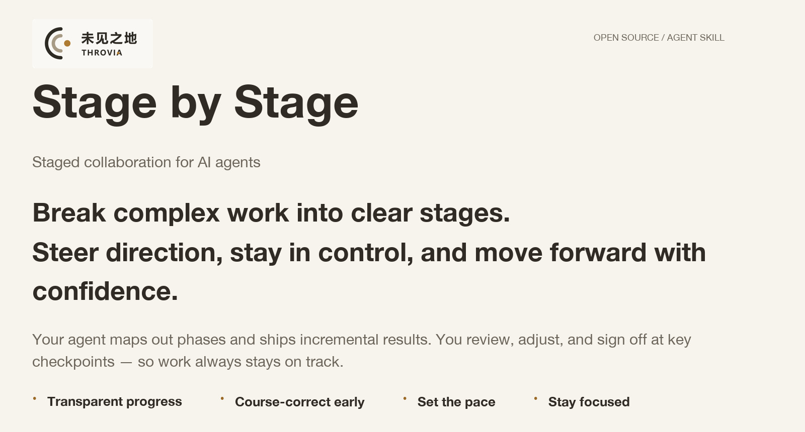
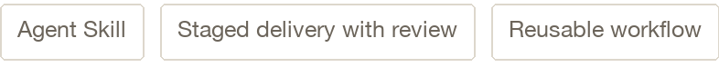
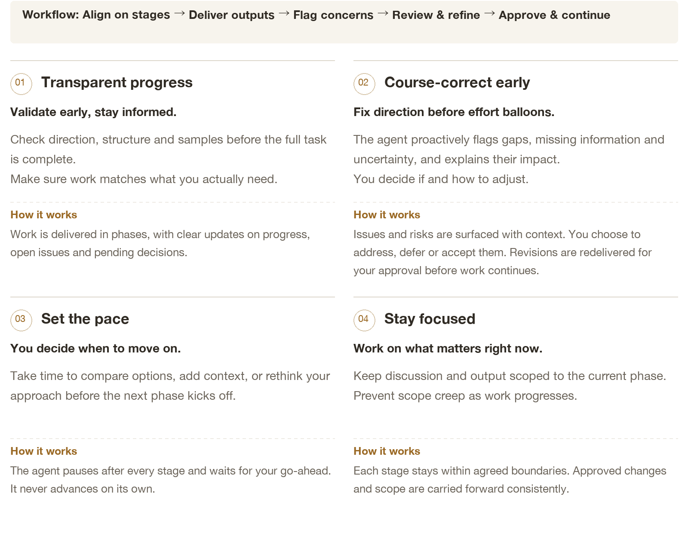
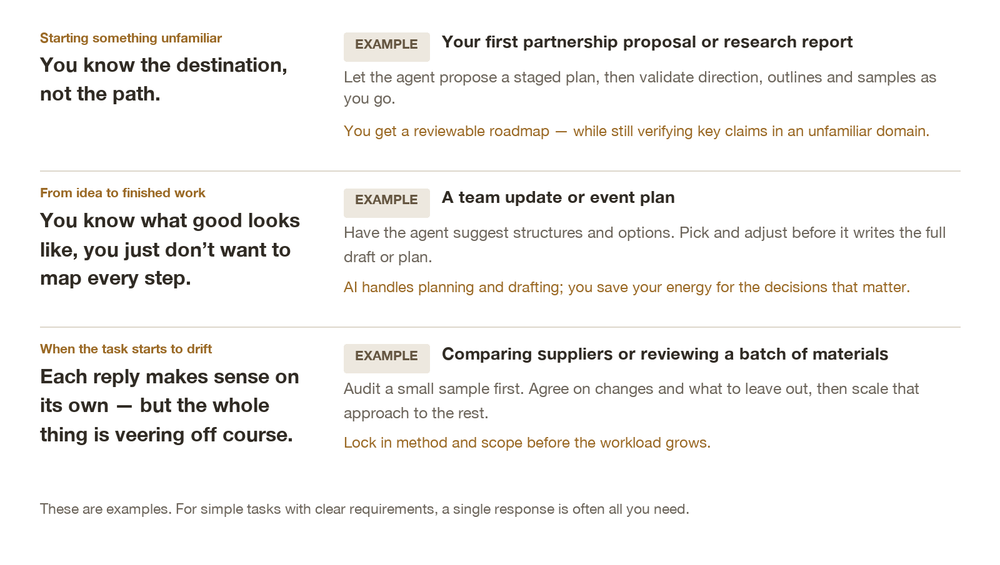

<picture>
  <source media="(max-width: 600px)" srcset="assets/readme-hero-en-mobile.png">
  
</picture>

[Why use it](#value) · [Use cases](#scenes) · [Demo](#demo) · [Install](#install) · [Get started](#start) · [FAQ](#faq) · [简体中文](README.zh-CN.md)

You know what you need to deliver — you just don’t have every step figured out yet.<br>
Stage by Stage lets your agent propose a staged plan, then execute only after you approve.<br>
Review outputs at each phase, tweak approach and scope, and decide when to move forward.



---

<a name="value"></a>

## [01 / Why use it](#value)

### Your judgment shapes where work goes next.

See progress, steer direction, and decide how to move forward.

<picture>
  <source media="(max-width: 600px)" srcset="assets/readme-values-en-mobile.png">
  
</picture>

> <strong>Not sure how to split your task?</strong> The agent will suggest stages for you to review and adjust. If you already have a plan, it will follow that instead.

---

<a name="scenes"></a>

## [02 / Use cases](#scenes)

### For work that needs your judgment — not just more output.

Ideal when each step builds on the last, and a wrong call early means heavy rework later.

<picture>
  <source media="(max-width: 600px)" srcset="assets/readme-scenes-en-mobile.png">
  
</picture>

---

<a name="demo"></a>

## [03 / Demo](#demo)

### From supplier data to a comparison you can use.

Five gift suppliers, order quantities, a budget, and a delivery deadline. Agree on a plan, refine a two-supplier sample, then compare all five.


<sub>Six slides, 10 seconds each, on a loop. Based on excerpts and summaries from the test conversation. Quoted excerpts are translated from Chinese.</sub>

> <strong>The takeaway:</strong> Your agent helps plan the work. You review the output, adjust the method and scope, and see those decisions carried into the next stage.
---

<a name="install"></a>

## [04 / Install](#install)

### Pick the setup that works for you.

Download the package and move the folder yourself, or use the command line.

**[Download the skill ZIP ↓](https://github.com/THROVIA/stage-by-stage/raw/refs/heads/main/stage-by-stage.zip)**

> Downloading the ZIP doesn’t install the skill. The same package works on Windows and macOS with a compatible AI tool. Use either method below to install it.

<table>
<tr>
<td>
<h3>A · Manual installation</h3>
<p><strong>Download → Extract → Move the folder</strong></p>
<ol>
<li>Extract the ZIP. Open <code>stage-by-stage</code> and check that <code>SKILL.md</code> is directly inside.</li>
<li>Move the whole folder, including <code>assets</code> and <code>agents</code>, to the location for your tool.</li>
<li>Open your AI tool and invoke the skill. If it doesn’t appear, restart the tool and check the folder location.</li>
</ol>
<table>
<thead>
<tr>
<th>Tool</th>
<th>macOS / Linux</th>
<th>Windows</th>
</tr>
</thead>
<tbody><tr>
<td>Codex</td>
<td><code>~/.agents/skills/stage-by-stage/</code></td>
<td><code>%USERPROFILE%\.agents\skills\stage-by-stage\</code></td>
</tr>
<tr>
<td>Claude Code</td>
<td><code>~/.claude/skills/stage-by-stage/</code></td>
<td><code>%USERPROFILE%\.claude\skills\stage-by-stage\</code></td>
</tr>
</tbody></table>
<p>These are personal installation folders. <code>~</code> and <code>%USERPROFILE%</code> mean your home folder; the full path depends on your account and environment.</p>
<details>
<summary>Where do I find the folder?</summary>
<ul>
<li><strong>macOS:</strong> In Finder, press <code>⌘⇧G</code> and enter the parent folder, such as <code>~/.agents/skills/</code>. Create any missing folders.</li>
<li><strong>Windows:</strong> Paste <code>%USERPROFILE%\.agents\skills\</code> into the File Explorer address bar.</li>
</ul>
<p>The path should end in <code>…/skills/stage-by-stage/SKILL.md</code>. Avoid accidentally nesting one <code>stage-by-stage</code> folder inside another.</p>
<p>If your tool runs in WSL, a container or a remote environment, install the skill there. If it’s already installed and working, you don’t need to install it again.</p>
</details>

</td>
</tr>
</table>

<table>
<tr>
<td>
<h3>B · Command-line installation</h3>
<p><strong>Install directly from GitHub</strong></p>
<p>You’ll need Node.js 22.20 or later and an internet connection to run the Skills CLI. Run the command for your tool in macOS Terminal or Windows PowerShell. There’s no need to download the ZIP first.</p>
<p><strong>Terminal · Codex</strong></p>
<pre lang="text"><code>npx skills add THROVIA/stage-by-stage --skill stage-by-stage -a codex -g --copy
</code></pre>
<p><strong>Terminal · Claude Code</strong></p>
<pre lang="text"><code>npx skills add THROVIA/stage-by-stage --skill stage-by-stage -a claude-code -g --copy
</code></pre>
<p>Choose the command for the tool you use. <code>-g</code> makes the skill available across your projects; <code>--copy</code> copies the files instead of creating links.</p>
<details>
<summary>Already downloaded and extracted the ZIP?</summary>
<p>Run the command from the folder containing <code>stage-by-stage</code>, replacing <code>THROVIA/stage-by-stage</code> with <code>./stage-by-stage</code>. You can also use the full folder path in quotes.</p>
</details>
<p><a href="https://github.com/vercel-labs/skills/blob/main/docs/commands.md">Skills CLI reference</a> · <a href="https://learn.chatgpt.com/docs/build-skills">Codex skills</a> · <a href="https://code.claude.com/docs/en/skills">Claude Code skills</a></p>
<p>These instructions cover local installations. Web and cloud tools may use a different import process.</p>

</td>
</tr>
</table>

---

<a name="start"></a>

## [05 / Get started](#start)

### Bring a task you’re working on.

Share your goal, materials and constraints — you don’t need to plan every stage in advance.


**Codex · In the AI chat**

```text
$stage-by-stage
```

**Claude Code · In the AI chat**

```text
/stage-by-stage
```

In the Codex CLI or IDE extension, you can also use `/skills` to select it. For other interfaces, use the tool’s skill selector.

### Example task

```text
Use stage-by-stage to help me compare suppliers for an upcoming event.
I’ll share our requirements and the supplier information. Focus on quantity, total cost and arrival dates. Suggest the stages first and check with me before starting.
```

Adapt this to your own task. If you already have stages in mind, include them; the skill will follow the plan you agree on.

---

<a name="faq"></a>

## [06 / FAQ](#faq)

<details open>
<summary><strong>Can’t I just say “work step by step and wait for me to confirm”?</strong></summary>

> For simple tasks, that may be enough.
>
> Stage by Stage adds a reusable set of rules: agree on stages, deliver reviewable work, flag issues, apply requested changes, and wait for your go-ahead. You don’t have to spell all of that out for every task.

</details>

---


<details>
<summary><strong>What if I don’t know how to divide the task into stages?</strong></summary>

> That’s fine.
>
> The agent will suggest a short plan, including what each stage produces and what you’ll review. You can adjust the plan before work starts. If you already have an agreed plan, it will follow that.

</details>

---


<details>
<summary><strong>Won’t all these check-ins slow me down?</strong></summary>

> Stages should end where your input matters most: an outline, a decision, or a sample that shapes the next part of the work. You don’t need to approve every small action.
>
> You can adjust the stages, or explicitly ask the agent to stop pausing between them.

</details>

---


<details>
<summary><strong>Do I have to resolve every issue before moving on?</strong></summary>

> No. You decide what to handle now and what to leave for later. The agent should keep unresolved issues visible when they affect work, rather than treating them as settled.
>
> If missing information prevents reliable progress, it should explain what’s blocked and what it needs to continue.

</details>

---


<details>
<summary><strong>How is this different from other planning skills?</strong></summary>

> Choose based on the help you need. Each skill has a different focus; their capabilities can overlap.
>
> | Skill | You want to… | Main focus |
> | --- | --- | --- |
> | **Stage by Stage** | Get help planning, review work as it takes shape, and decide what happens next. | Agree on stages, review outputs and issues, apply changes before continuing, and carry decisions forward. |
> | [Planning with Files](https://github.com/OthmanAdi/planning-with-files) | Pick up a long task without losing the plan, findings or progress. | Save plans, findings and task state in files so work resumes across sessions or interruptions. |
> | [Phase-Gated Workflow](https://github.com/sayed-moin-ahmed/phase-gated-workflow) | Move a software project through defined phases, with approval before the next one. | Organize research, design, review, implementation and validation around phase approvals. |
>
> Based on linked project documentation, not a head-to-head performance test.

</details>

---


<details>
<summary><strong>How does it work with Task Brief? Do I need both?</strong></summary>

> [Task Brief](https://github.com/THROVIA/Task_Brief) helps you agree on what problem to solve and how much scope to take on.
>
> Stage by Stage helps you review and steer work as it progresses. You can use either on its own. If goals and scope are still unclear, start with Task Brief.

</details>

---


<details>
<summary><strong>What if AI skips ahead or ignores a change?</strong></summary>

> Tell it which stage you’re on and what still needs approval. Ask it to correct the current work, and verify the skill is loaded.
>
> If it keeps happening, save the relevant conversation and share it as feedback. The skill sets collaboration rules; how well they’re followed still depends on the model and tool.

</details>

---

<a name="feedback"></a>

## [07 / Feedback & THROVIA](#feedback)

### Found it useful? Star the project or tell us how it went.

Questions, ideas and examples from your own work are welcome. If you share a conversation, remove any sensitive information first.

**[☆ Star on GitHub](https://github.com/THROVIA/stage-by-stage)** · **[Follow THROVIA on X](https://x.com/Throvia)** · **[Ask a question or share feedback](https://github.com/THROVIA/stage-by-stage/issues)**

When reporting an issue, include the task, the relevant reply and what you expected to happen.

---


**Brenda Shi · THROVIA**

Published by 上海未见之地科技有限公司.

[SKILL.md](SKILL.md) · [Changelog](CHANGELOG.md) · [MIT License](LICENSE) · [Brand usage](BRAND_USAGE.md)

skill instructions and documentation use the MIT license. Names, logos and brand images are covered by the separate brand usage notice.

Copyright (c) 2026 Brenda Shi · THROVIA.
