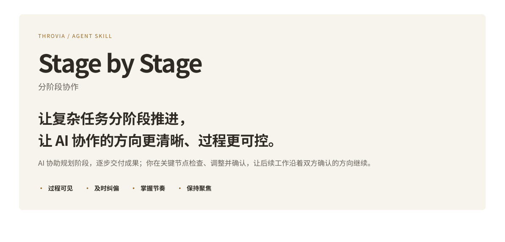
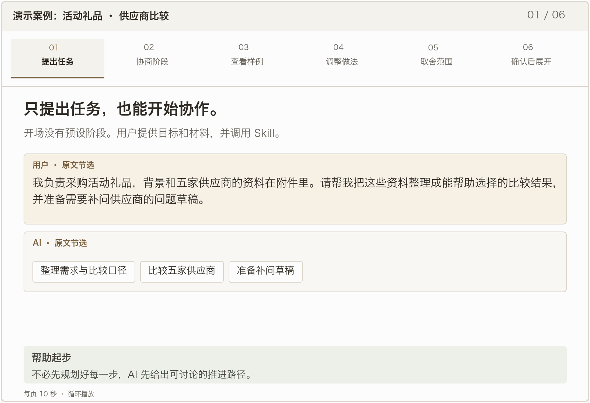

[核心价值](#value) · [适用场景](#scenes) · [Demo 演示](#demo) · [安装教程](#install) · [快速开始](#start) · [常见问题](#faq) · [English](README.md)

你知道最终需要什么，却未必已经想好每一步怎么做。

Stage by Stage 让 AI 先提出阶段安排，再按确认后的计划执行。

通过查看阶段成果，你可以及时调整做法与范围，并决定何时进入下一阶段。

开源 Agent Skill · Codex · Claude Code · MIT · 技能与文档

<a id="value"></a>

## 让你的判断，真正影响后续工作。

从看到成果，到调整方向，再到决定如何继续。

协商阶段 → 交付当前成果 → 提示关键问题 → 审阅与调整 → 确认后继续

### 过程可见

提前判断，心中有数

在任务全部完成之前，就能检查方向、结构或样例，判断是否符合实际需要。

**如何实现** 分阶段交付成果，说明当前进展、问题和待确认事项。

### 及时纠偏

及时发现问题，在继续投入前调整

AI 主动提醒当前阶段的关键问题、信息缺口与不确定性，说明可能的影响，帮助你判断是否需要调整。

**如何实现** 交付成果时提示关键问题与影响；由你决定处理或暂缓，需修改时重新交付，再经确认继续。

### 掌握节奏

由你决定何时继续

需要比较、补充信息或重新考虑时，保留判断空间，决定下一步如何推进。

**如何实现** 每个阶段完成后暂停等待确认，不自行展开下一阶段。

### 保持聚焦

围绕当前重点推进

让讨论和产出集中于当前要解决的问题，避免工作范围在推进中不断扩大。

**如何实现** 聚焦当前阶段，在后续执行中沿用已确认的修改与范围。

**还没想好怎么分阶段？** AI 会先提出安排，供你审阅和调整；已有计划，也可以直接沿用。

<a id="scenes"></a>

## 当任务需要你的判断，而不只是更多产出时：

尤其适合前后相互依赖、前一步没确定就可能带来后续返工的工作。

从陌生任务开始

### 知道要交付什么， 还不清楚怎么做。

**示例场景：第一次做一份合作方案或研究报告**

让 AI 先提出阶段安排，再通过方向、提纲与样例逐步判断。

你获得的是可审阅的推进路径；陌生领域的关键结论仍需核实。

把想法变成成果

### 心里有判断， 不想独自规划每一步。

**示例场景：写汇报、设计活动**

让 AI 提出结构或备选方案，你选择和调整，再展开正文与执行安排。

让 AI 承担规划和起草，把精力留给重要判断。

让后续工作有依据

### 每一轮都像有道理， 整体却越来越偏。

**示例场景：比较供应商、整理一批资料**

先检查小范围样例，明确要改什么、哪些暂不做，再按确认后的方式展开。

在工作继续扩大前，先校准做法和范围。

场景用于说明适用方式。要求明确、可以一次完成的简单任务，不必强行拆分。

<a id="demo"></a>

## 从一个采购任务，到一份经你确认的比较结果。



六页循环演示，每页 10 秒。依据试跑对话的节选与摘要整理。

[中文 GIF](assets/demo-zh.gif) · [English GIF](assets/demo-en.gif)

<details>
<summary>按自己的节奏阅读完整演示</summary>

### 只提出任务，也能开始协作。

开场没有预设阶段。用户提供目标和材料，并调用 Skill。

用户 · 原文节选

我负责采购活动礼品，背景和五家供应商的资料在附件里。请帮我把这些资料整理成能帮助选择的比较结果，并准备需要补问供应商的问题草稿。

AI · 原文节选

建议分三阶段推进：

整理需求与比较口径 · 比较五家供应商 · 准备补问草稿

**帮助起步**不必先规划好每一步，AI 先给出可讨论的推进路径。

### AI 提出安排，你可以调整。

用户把三阶段改成四阶段，增加“两家样例”这个检查机会。

用户 · 阶段安排摘要

1 定比较方法 · 2 做 A、C 两家样例 · 3 展开五家并更新回信 · 4 形成建议与补问

AI · 原文节选

按你提出的四个阶段推进。我现在只做阶段1：阅读附件，提出比较项目、筛选条件和表格呈现方式，交给你审阅后再进入两家供应商的样例整理。

**掌握节奏**阶段安排可以协商，任务按你确认后的路径执行。

### 先看两家，判断比较方式是否合用。

确认比较方法后，AI 先交付 A、C 的实际样例，其他三家尚未展开。

| 样例节选 | A · 拾帆定制 | C · 禾布印务 |
| --- | --- | --- |
| 含税总支出 | 3,660 元 | 3,703 元 |
| 到货信息摘要 | 预计 12 月 14 日发出；运输一般需 1–2 天 | 预计 12 月 12–14 日到货 |
| 按时到货 | 待确认 | 待确认 |

以上为初版样例的信息摘要。初版已区分预计与承诺；日期沿用案例设定。

**过程可见**有具体成果可以检查，不必只凭抽象提纲判断方向。

### 把关键区别，变成清楚的比较项。

用户 · 原文节选

表里请把发货日、预计到货日和明确承诺的最晚到货日分开；“预计”不能写成已经保证。

| 修改后节选 | A · 拾帆定制 | C · 禾布印务 |
| --- | --- | --- |
| 发货日 | 预计 12 月 14 日，未保证 | 未提供 |
| 预计到货日 | 推算为 12 月 15–16 日 | 预计 12 月 12–14 日 |
| 明确承诺的最晚到货日 | 未提供 | 未提供明确承诺 |

**及时纠偏**先把比较方式调整合适，再让后面的工作沿用。

### 建议可以更全面，范围仍由你决定。

应用户要求，AI 补充了额外考虑点；用户决定暂缓其中两项。

用户 · 原文节选

另外，你说的提前考虑点，我认为提议3和提议4现在有点过了，暂不考虑

AI · 原文节选

收货检查安排、签约／收款／开票主体核对暂缓，不作为当前比较项或补问项。

**保持聚焦**由你决定哪些现在处理，避免建议不断变成额外工作。

### 你的确认，真正改变后续执行。

用户 · 原文节选

这两家这样整理可以。下面是我新收到的回信，请按确认后的方法整理全部五家，把新信息更新进去；旧说法被明确修订的地方也标出来。

后续五家比较 · 结果摘要

保留三类日期字段 · 沿用补充的比较维度 · 标明新旧信息修订 · 保留两项暂缓决定

先完成全部五家的条件核对；选择建议留在下一阶段。

**确认后推进**修改与范围得到延续，当前阶段仍然保持聚焦。

</details>

**这段演示的价值：**AI 帮你开始规划；你通过阶段成果调整做法、决定范围，再让它带着这些决定继续。

<a id="install"></a>

## 两种安装方式，按你的习惯选择。

可以手动放置文件夹，也可以在终端使用命令行安装。

[下载 Skill 文件包 ↓](https://github.com/THROVIA/stage-by-stage/raw/refs/heads/main/stage-by-stage.zip)

**点击按钮只会下载 ZIP，不会自动安装。**<br>
同一文件包可供 Windows 和 macOS 使用，前提是电脑上已有支持 Skill 的 AI 工具。解压后，任选下面一种方式完成安装。

方式 A / 手动安装

### 下载 → 解压 → 放入对应文件夹

1. 解压 ZIP，找到 `stage-by-stage` 文件夹，打开后应直接看到 `SKILL.md`。
2. 将整个文件夹放到下表对应位置，保留 `assets` 和 `agents` 等随附文件。
3. 回到 AI 工具中调用；如果没有出现，重新打开工具并检查安装位置。

| 工具 | macOS / Linux 个人安装目录 | Windows 个人安装目录 |
| --- | --- | --- |
| Codex | `~/.agents/skills/stage-by-stage/` | `%USERPROFILE%\.agents\skills\stage-by-stage\` |
| Claude Code | `~/.claude/skills/stage-by-stage/` | `%USERPROFILE%\.claude\skills\stage-by-stage\` |

`~` 和 `%USERPROFILE%` 都代表你自己的用户主目录。目录结构可以相同，但完整路径会随用户名和运行环境变化。

<details>
<summary>如何找到目录、检查有没有放对？</summary>

macOS：访达按 `⌘⇧G`，输入父目录，例如 `~/.agents/skills/`；不存在时先创建相应文件夹。<br>
Windows：在文件资源管理器地址栏输入 `%USERPROFILE%\.agents\skills\`。带点的目录可能默认隐藏。

最终路径应为 `…/skills/stage-by-stage/SKILL.md`，避免多嵌套一层 `stage-by-stage/stage-by-stage`。<br>
如果工具运行在 WSL、容器或远程环境中，应安装到那个环境的用户目录。已有可正常调用的安装，无需重复添加。

</details>

方式 B / 命令行安装

### 在终端从 GitHub 仓库安装

需要 Node.js 22.20 或更新版本，并联网运行 Skills CLI。在 macOS 终端或 Windows PowerShell 中执行所用工具对应的命令，无需手动下载 ZIP。

**终端 · 安装到 Codex**

```text
npx skills add THROVIA/stage-by-stage --skill stage-by-stage -a codex -g --copy
```

**终端 · 安装到 Claude Code**

```text
npx skills add THROVIA/stage-by-stage --skill stage-by-stage -a claude-code -g --copy
```

按所用工具选择一条命令。`-g` 表示个人安装、可跨项目使用；`--copy` 表示复制文件而非创建链接。如果已下载并解压 ZIP，可在其上一级目录把 `THROVIA/stage-by-stage` 改为 `./stage-by-stage`，或改成加引号的完整路径。

[Skills CLI 命令说明 ↗](https://github.com/vercel-labs/skills/blob/main/docs/commands.md)

工具官方说明：[Codex Skills ↗](https://learn.chatgpt.com/docs/build-skills) · [Claude Code Skills ↗](https://code.claude.com/docs/en/skills)。以上为本地个人安装；云端、网页端按各自的导入方式处理。

<a id="start"></a>

## 带上一项任务，就可以开始。

准备目标、已有资料和关键约束，不必预先写好全部阶段。

**安装完成后，在 AI 对话框中调用，再提供任务。**下列指令不要粘贴到终端。

**Codex · AI 对话框 · 不是终端命令**

```text
$stage-by-stage
```

**Claude Code · AI 对话框 · 不是终端命令**

```text
/stage-by-stage
```

Codex CLI 或 IDE 扩展也可输入 `/skills` 后选择；Claude Code 在对话中输入斜杠指令，再描述任务。其他界面使用其提供的 Skill 选择入口。

一条任务输入示例

```text
请使用 stage-by-stage 帮我整理这次活动的供应商比较。
我会提供需求和供应商资料，重点关注数量、总预算和到货时间。请先提出阶段安排，和我确认后再开始。
```

以上仅为示例，也可根据自己的任务自行修改尝试。

已经有自己的阶段安排，可以直接提供；Skill 会沿用已确认的计划。

<a id="faq"></a>

## 关于使用、边界与选择。

<details>
<summary>直接说“分步骤做，每步等我确认”，不就可以了吗？</summary>

简单任务可能足够。<br>
Stage by Stage 把划分阶段、交付成果、提醒问题、落实修改和确认后继续整理成可复用规则，方便在不同任务中保持一致的协作方式。

</details>

<details>
<summary>我不知道该分几步，也能使用吗？</summary>

可以。<br>
AI 先提出简短的阶段建议，说明每一步交付什么、需要你判断什么；你可以调整，确认后再开始。已有安排则直接沿用。

</details>

<details>
<summary>每一步都要确认，会不会反而增加负担？</summary>

阶段围绕方向、选择、样例等影响后续工作的成果设置，不把每个小动作都变成审批。<br>
你可以调整阶段，也可以明确取消暂停要求。

</details>

<details>
<summary>AI 提醒的问题，必须全部解决才能继续吗？</summary>

不必。<br>
你决定现在处理还是暂缓。暂缓事项仍会保留限制；如果某个缺口确实使后续工作无法可靠完成，AI 应说明受影响的部分与继续所需条件。

</details>

<details>
<summary>与其他规划、分阶段执行类 Skill 有什么区别？</summary>

可以按你当前最需要的帮助来选择。<br>
以下比较规则侧重点，不代表其他 Skill 没有相近能力。

| Skill | 你现在希望…… | 主要侧重点 |
| --- | --- | --- |
| **Stage by Stage** | 有人协助规划，在看见阶段成果后作判断，并让后续工作沿着确认的方向继续。 | 协商阶段；交付可审阅成果并提醒关键问题；落实修改、等待确认；保持当前聚焦并继承已定范围。 |
| [Planning with Files ↗](https://github.com/OthmanAdi/planning-with-files) | 长任务跨多轮或中断后，仍能找回计划、发现与进度。 | 以文件保存计划、发现和执行状态，支持上下文延续与任务恢复。 |
| [Phase-Gated Workflow ↗](https://github.com/sayed-moin-ahmed/phase-gated-workflow) | 让软件工程任务按明确阶段推进，在进入下一阶段前审核批准。 | 以研究、设计、审查、实施、验证五种工程模式组织工作，设置阶段批准要求。 |

对比依据为所链接的项目公开说明，非实际效果排名。

</details>

<details>
<summary>与 Task Brief 有什么区别，需要搭配使用吗？</summary>

[Task Brief](https://github.com/THROVIA/Task_Brief) 帮你明确当前该解决什么、做到什么程度；<br>
Stage by Stage 帮你分阶段交付、审阅和推进。两者可独立使用；目标和范围尚不清晰时，也可以先用 Task Brief 对齐。

</details>

<details>
<summary>如果 AI 还是提前执行，或没有落实修改，怎么办？</summary>

指出当前阶段和未确认的内容，要求先修正当前成果，并检查 Skill 是否已加载。<br>
若反复出现，保留相关对话用于反馈。<br>
Skill 提供协作规则，实际执行仍受模型和所用工具影响。

</details>

<a id="feedback"></a>

## 如果它帮到了你，欢迎 Star、分享与交流。

为项目点一个 Star，方便下次找到，也让更多人发现它。使用中有问题或新的想法，欢迎交流与反馈；分享对话时，请先移除敏感信息。

- [☆ Star 项目](https://github.com/THROVIA/stage-by-stage)
- [关注 THROVIA · X ↗](https://x.com/Throvia)
- [交流与反馈 ↗](https://github.com/THROVIA/stage-by-stage/issues)

欢迎在 Issue 中说明任务、相关回复与后续结果，也可以关注 THROVIA 的 X 获取使用案例和项目动态。

---


**Brenda Shi · THROVIA**

发布方：上海未见之地科技有限公司。

[SKILL.md](SKILL.md) · [Changelog](CHANGELOG.md) · [MIT License](LICENSE) · [Brand usage](BRAND_USAGE.md)

Skill 指令及文档采用 MIT 许可；名称、Logo 和品牌图片的使用范围见品牌说明。

Copyright (c) 2026 Brenda Shi · THROVIA.
